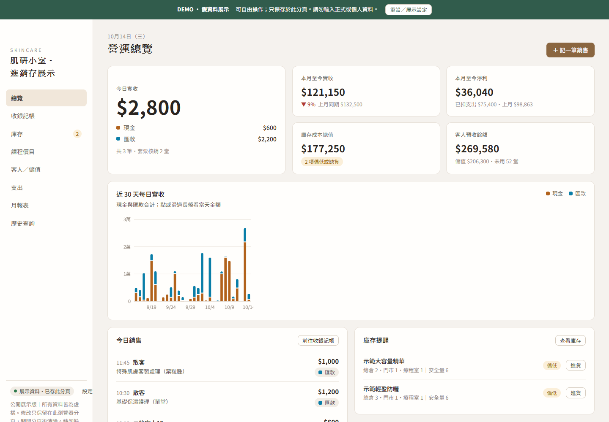

# 肌研小室・進銷存展示

適用桌面與手機的皮膚管理工作室進銷存操作展示。所有商品、客人、價目與帳務皆為虛構，供作品展示使用。

## 線上操作

[開啟展示網站](https://mina201199.github.io/inventory-showcase/)

開啟即載入近三個月的示範帳務，可直接操作，不需登入。



[查看手機版畫面](assets/mobile.png)

- 總覽：每日營收、收款方式、庫存提醒。
- 收銀記帳：商品、課程、套票、儲值扣款。
- 庫存：進貨、調撥、領用、盤點與商品維護。
- 客人／儲值：示範客人資料、儲值與套票餘額。
- 支出、月報表、歷史查詢與 CSV 匯出。

資料只保存在目前分頁的 `sessionStorage`。重新整理仍保留，關閉分頁後結束；瀏覽器的「還原已關閉分頁」可能恢復該分頁資料。上方「重設／展示設定」可重設假資料。請勿輸入真實客人、電話、帳務或其他個人資料。

## 與正式產品隔離

此 repository 是獨立的展示版本，沒有正式後端、Google Sheets、登入金鑰、正式資料或部署設定。展示資料客戶端沒有網路 API，頁面 CSP 使用 `connect-src 'none'` 阻擋資料連線。訪客間不共用帳本，操作不會傳送至正式系統。

網站透過 GitHub Pages 提供靜態檔案。GitHub 仍會接收一般網站請求。這份展示不代表正式版的驗證、權限、雲端交易保存與同步架構。

## 系統架構

採用純前端架構，將介面、資料操作與展示資料保存分開管理：

```text
桌面／手機瀏覽器
  └─ 介面層：收銀、庫存、客人儲值、課程、支出、報表
      └─ DemoClient：讀取、批次修改、替換資料
          └─ sessionStorage：目前分頁的展示帳本

GitHub main → GitHub Actions → 建置與測試 → GitHub Pages
```

- **介面層**：`src/app.html` 保留業務操作與報表，`demo-ui.js` 負責展示設定、狀態提示與啟動流程。
- **資料操作層**：`DemoClient` 統一處理資料讀取、批次修改與替換；重設時重新產生假資料。
- **儲存層**：使用 `sessionStorage` 保存目前分頁的操作，不呼叫正式 API 或 Google Sheets。
- **部署層**：GitHub Actions 建置並測試展示程式，再由 GitHub Pages 提供靜態網站。

## 技術與框架

| 項目 | 使用技術 |
| --- | --- |
| 前端 | HTML、CSS、原生 JavaScript，未使用前端框架 |
| 響應式介面 | CSS Grid、Flexbox、Media Queries |
| 資料保存 | 瀏覽器 `sessionStorage` |
| 建置工具 | Node.js 自訂建置腳本，無第三方套件依賴 |
| 自動化測試 | Node.js 內建 `node:test`、`assert`、`vm` |
| 本機預覽 | Python 內建 HTTP 靜態伺服器 |
| 版本與部署 | Git、GitHub、GitHub Actions、GitHub Pages |

## 工程亮點

- **展示與正式產品隔離**：使用獨立 repository、假資料與展示儲存空間，讓訪客自由操作，不影響正式帳本。
- **以交易紀錄推導狀態**：庫存、儲值餘額與套票剩餘堂數由期初資料及交易紀錄計算，減少衍生數值各自維護造成的不一致。
- **批次保存與失敗處理**：同一次操作的多筆修改先合併成新快照，再一次保存；儲存失敗時保留客戶端舊快照並提示錯誤，避免誤報成功。
- **自動化驗證與發布**：每次推送 `main` 先建置並執行 9 項測試，通過後才部署至 GitHub Pages。
- **假資料與連線隔離測試**：檢查示範商品及客人資料、程式中是否包含正式連線，以及資源路徑是否支援 GitHub Pages 子路徑；頁面 CSP 使用 `connect-src 'none'` 禁止資料連線。
- **桌面與手機共用介面**：依螢幕尺寸調整導覽、表格與操作區，並已驗證進貨、結帳、重新整理保存與重設示範資料流程。

## 本機執行

需要 Node.js 24 與 Python 3，無第三方套件。

```powershell
node scripts/build.mjs
node --test tests/*.test.cjs
python -m http.server 8799 --bind 127.0.0.1
```

開啟 http://127.0.0.1:8799 。不要將伺服器目錄設成正式產品的根目錄。

## 驗證操作

1. 總覽應顯示今日銷售與庫存提醒；庫存應有 26 項示範商品。
2. 新增一筆商品進貨，確認庫存增加，重新整理後仍保留。
3. 在收銀記帳選商品並結帳，確認銷售紀錄增加、庫存扣減。
4. 切換客人、課程、支出、月報表及歷史查詢，確認可正常操作。
5. 上方展示設定 → 重設示範資料，確認剛才的操作紀錄被假資料替換。
6. 可在瀏覽器開發工具 Network 檢查：沒有 `/api/`、Apps Script 或正式網站請求。

## 程式結構

- `src/app.html`：獨立介面與假資料產生器。
- `demo-ui.js`：展示設定、狀態文字與啟動流程，由建置腳本嵌入頁面。
- `demo-client.js`：僅使用目前分頁的資料保存，不呼叫任何 API。
- `scripts/build.mjs`：產生 `index.html`，不讀取外部產品檔案。
- `tests/`：資料保存、假資料與連線隔離測試。
- `.github/workflows/pages.yml`：測試通過後，只上傳展示頁及必要資源至 GitHub Pages。

修改來源後，執行建置與測試，再提交產生的 `index.html`。推送 `main` 後會自動更新展示網站。
